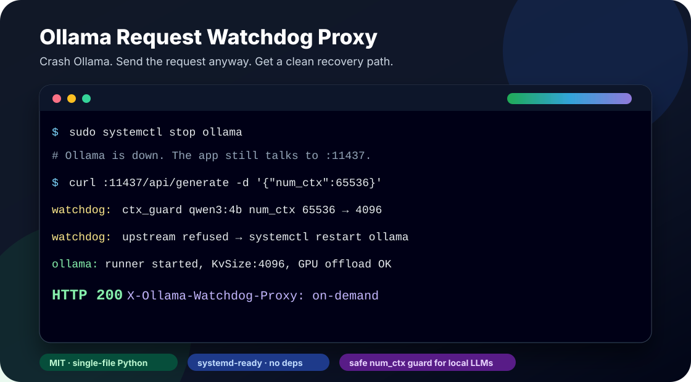

# Ollama Request Watchdog Proxy



**A tiny systemd-ready proxy that keeps local Ollama apps from turning one bad request into a dead service.**

Put it between LiteLLM / Open WebUI / your app and Ollama:

```text
app → 127.0.0.1:11437 → watchdog proxy → 127.0.0.1:11434 → Ollama
```

When Ollama is down, the proxy can restart it. When a request tries to sneak in a ridiculous `num_ctx`, the proxy clamps it before your GPU melts. When the client disconnects, it does **not** panic-restart a healthy Ollama.

## Why this exists

Local LLM stacks fail in boring, expensive ways:

- a wrapper sends `num_ctx=65536` to a 12 GB GPU;
- Ollama spends minutes loading or falls back to CPU;
- nginx / LiteLLM sees upstream closes and starts returning 502;
- a naive watchdog restarts Ollama on every `BrokenPipeError`, making things worse.

This proxy is a small safety rail for exactly that mess.

## Features

- **On-demand recovery**: restart `ollama.service` when the upstream is genuinely unavailable or times out before the first byte.
- **Context guard**: inject or clamp `options.num_ctx` for `/api/generate` and `/api/chat`.
- **Per-model limits**: set tighter caps for heavy models and looser defaults for small ones.
- **No restart storms**: cooldown between restarts.
- **Client disconnect safe**: `BrokenPipeError` / `ConnectionResetError` are logged as client closes, not treated as Ollama failures.
- **Real health endpoint**: `/health` checks Ollama `/api/tags` instead of returning fake green.
- **No Python dependencies**: standard library only.

## Install

```bash
git clone https://github.com/megamen32/ollama-request-watchdog-proxy.git
cd ollama-request-watchdog-proxy
sudo ./scripts/install.sh
```

Then point your app at:

```text
http://127.0.0.1:11437
```

For LiteLLM, use it as the Ollama base URL:

```yaml
litellm_params:
  model: ollama/qwen3:4b-instruct
  api_base: http://127.0.0.1:11437
```

## Configuration

The installer creates a systemd drop-in from `systemd/20-hardening.conf.example`:

```ini
[Service]
Environment="OLLAMA_PROXY_FIRST_BYTE_TIMEOUT_S=180"
Environment="OLLAMA_PROXY_RESTART_COOLDOWN_S=120"
Environment="OLLAMA_PROXY_MAX_NUM_CTX=8192"
Environment="OLLAMA_PROXY_ENFORCE_DEFAULT_NUM_CTX=1"
Environment="OLLAMA_PROXY_MODEL_CTX_LIMITS=qwen-fast=4096,qwen3:4b-instruct=4096,qwen3-coder:30b=4096"
```

Apply changes:

```bash
sudo systemctl daemon-reload
sudo systemctl restart ollama-request-watchdog-proxy
```

## Demo: deliberately break Ollama

```bash
sudo systemctl stop ollama
curl -sS http://127.0.0.1:11437/api/tags -D-
```

Expected behavior:

```text
X-Ollama-Watchdog-Proxy: on-demand; retry-after-restart
HTTP/1.0 200 OK
```

Now try a dangerous context:

```bash
curl http://127.0.0.1:11437/api/generate \
  -H 'Content-Type: application/json' \
  -d '{"model":"qwen3:4b-instruct","prompt":"say ok","stream":false,"options":{"num_ctx":65536}}'
```

Watch the journal:

```bash
journalctl -u ollama-request-watchdog-proxy -f
```

You should see:

```text
ctx_guard path=/api/generate model='qwen3:4b-instruct' limit=4096 clamped_num_ctx=65536->4096
```

## Test

```bash
python3 -m py_compile src/ollama_request_watchdog_proxy.py
python3 -m unittest discover -s tests -p 'test_*.py'
```

## What this is not

This is not a full observability stack. It is a compact guardrail for local Ollama deployments. Pair it with proper metrics if you run a larger production gateway.

## License

MIT
