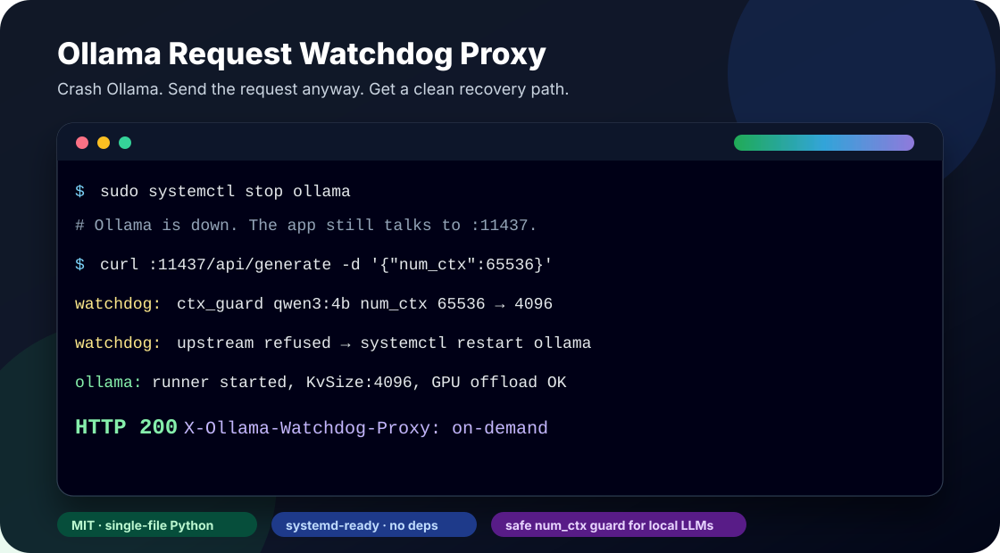

<p align="center">
  
</p>

<h1 align="center">Ollama Request Watchdog Proxy</h1>

<p align="center"><strong>Восстановление Ollama без лишних перезапусков.</strong></p>

<p align="center">
  <a href="README.md">English</a> · <a href="README.ru.md">Русский</a>
</p>

<p align="center">
  
  
  
</p>

Небольшой HTTP-прокси без сторонних библиотек. Размещается между приложением и Ollama, ограничивает чрезмерный контекст генерации и восстанавливает Ollama при определённых сбоях. Отключение клиента не вызывает перезапуск работающей модели.

## Зачем он нужен

Приложение может запросить слишком большой контекст (например, `num_ctx=65536`), зависнуть на загрузке модели или получить сетевой сбой. Watchdog:

- ограничивает `options.num_ctx` для `/api/chat` и `/api/generate`;
- поддерживает отдельные лимиты контекста для моделей;
- перезапускает указанную службу `OLLAMA_SERVICE` при подтверждённой недоступности Ollama;
- соблюдает интервал между перезапусками;
- не считает разорванное клиентом соединение проблемой Ollama;
- проверяет настоящий upstream через `/health`.

Работает на стандартной библиотеке Python и systemd.

## Совместная работа с Ollama Model Queue

**[Ollama Model Queue](https://github.com/megamen32/ollama-model-queue-proxy)** упорядочивает запросы и группирует их по моделям, чтобы реже выгружать и загружать модели. Watchdog отвечает за устойчивость и ограничения. Это **два самостоятельных проекта**, LiteLLM не требуется.

```text
Приложение (LiteLLM необязателен)
               |
               v
Model Queue   :11437  очередь по моделям
               |
               v
Watchdog      :11436  защита и восстановление
               |
               v
Ollama        :11434  инференс
```

Смотри **[совместную установку с точными портами](https://github.com/megamen32/ollama-model-queue-proxy/blob/main/docs/with-watchdog.ru.md)**. По умолчанию оба прокси могут использовать `11437`, поэтому для совместной работы watchdog нужно перевести на `11436`, а очередь направить на него.

## Установка на Linux

```bash
git clone https://github.com/megamen32/ollama-request-watchdog-proxy.git
cd ollama-request-watchdog-proxy
sudo ./scripts/install.sh
```

По умолчанию watchdog принимает запросы на `http://127.0.0.1:11437` и передаёт их в Ollama на `http://127.0.0.1:11434`. При уже установленной очереди сначала проверь существующие порты, чтобы избежать конфликта.

## Конфигурация

Используй systemd drop-in `/etc/systemd/system/ollama-request-watchdog-proxy.service.d/20-hardening.conf`:

```ini
[Service]
Environment="OLLAMA_PROXY_FIRST_BYTE_TIMEOUT_S=180"
Environment="OLLAMA_PROXY_RESTART_COOLDOWN_S=120"
Environment="OLLAMA_PROXY_MAX_NUM_CTX=8192"
Environment="OLLAMA_PROXY_ENFORCE_DEFAULT_NUM_CTX=1"
Environment="OLLAMA_SERVICE=ollama.service"
Environment="OLLAMA_PROXY_MODEL_CTX_LIMITS=qwen-fast=4096,qwen3:4b-instruct=4096"
```

Переменная `OLLAMA_SERVICE` позволяет выбрать нужный инстанс, например `embedding-ollama.service` для GPU. После изменений:

```bash
sudo systemctl daemon-reload
sudo systemctl restart ollama-request-watchdog-proxy.service
curl -fsS http://127.0.0.1:11437/health
```

Если используешь схему с двумя прокси, проверяй watchdog на порту `11436`, а очередь на `11437`.

## Проверка и тесты

```bash
journalctl -fu ollama-request-watchdog-proxy.service
python3 -m py_compile src/ollama_request_watchdog_proxy.py
python3 -m unittest discover -s tests -p 'test_*.py'
```

## Лицензия

MIT, подробности в [LICENSE](LICENSE).
